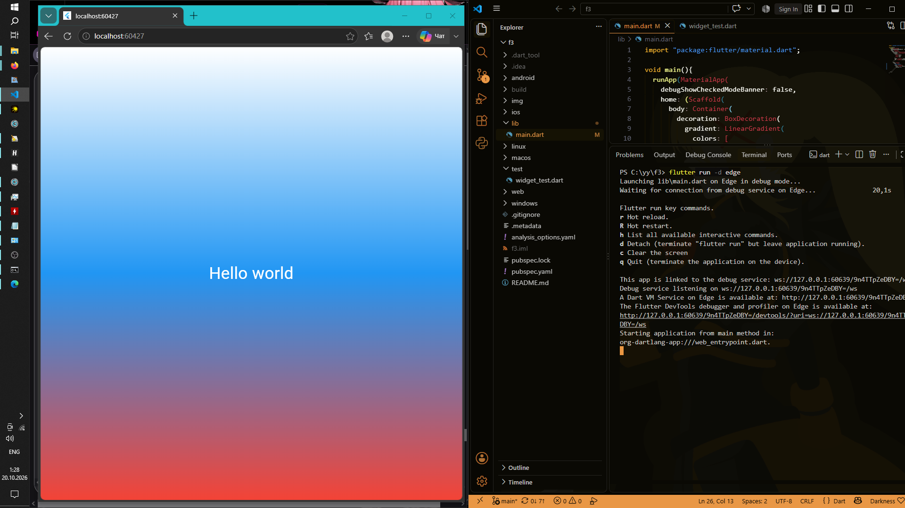

# Flutter 3

Репозиторий содержит материалы лабораторной работы №3, посвященной изучению основ кроссплатформенной разработки на фреймворке Flutter от Google. В рамках работы было создано первое веб-приложение, изучена базовая структура проекта, принципы построения дерева виджетов и инструменты отладки.

## Информация об авторе
* **ФИО:** Чумаченко Михаил
* **Группа:** ИСП-242

## Стек технологий и версии
* **Фреймворк:** Flutter 3.47.7
* **Язык программирования:** Dart 3.13.5
* **Целевая платформа:** Web (Edge)
* **Среда разработки:** Visual Studio Code (VS Code)

## Скриншот приложения


## Запуск


1. Клонировать репозиторий:
   ```bash
   git clone <url>
   ```
2. Перейти в папку проекта:
   ```bash
   cd f3
   ```
3. Получить зависимости проекта:
   ```bash
   flutter pub get
   ```
4. Запустить приложение в браузере Edge:
   ```bash
   flutter run -d edge
   ```

## Что изучили
В ходе выполнения лабораторной работы были освоены следующие концепции и инструменты:
1. **Архитектура Flutter:** Познакомились с понятием дерева виджетов (Widget Tree), принципом построения декларативного UI и различиями между `StatelessWidget` и `StatefulWidget`.
2. **Базовые виджеты:** Научились использовать и комбинировать корневые и структурные виджеты, такие как `MaterialApp`, `Scaffold`, `Container`, `Center` и `Text`.
3. **Стилизация интерфейса:** Освоили работу с цветами (класс `Colors`), настройку линейных градиентов (`LinearGradient` в `BoxDecoration`) и кастомизацию текста через `TextStyle`.
4. **Инструменты разработчика:** Изучили разницу между механизмами быстрой перезагрузки `Hot Reload` и `Hot Restart`, поработали со встроенной палитрой команд VS Code и инспектором `Flutter DevTools`.
